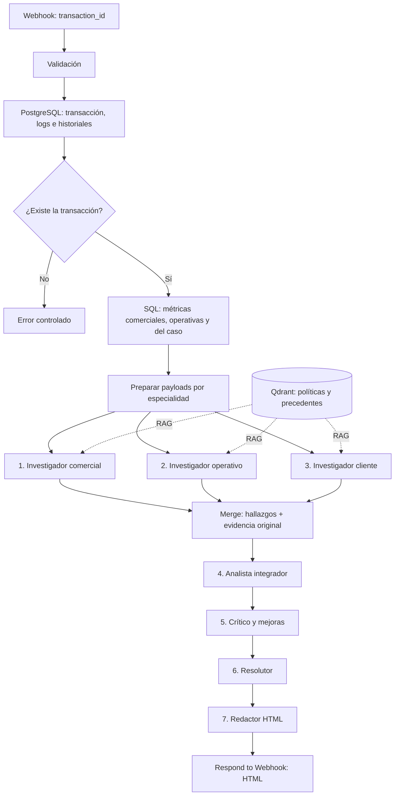

# Diagrama de la solución

[Arquitectura](README.md) · [Diagrama](DIAGRAMA_SOLUCION.md) · [RAG](RAG.md) · [Consultas SQL](QUERIES_SQL.md)

## Flujo completo

### Diagrama de la solución

## Secuencia de procesamiento

1. El webhook recibe `transaction_id` y n8n valida la entrada.
2. PostgreSQL obtiene la transacción, sus eventos y los historiales vinculados.
3. Los nodos SQL calculan las métricas antes de llamar a los agentes.
4. n8n prepara payloads específicos para los investigadores comercial, operativo y cliente.
5. Cada investigador recupera políticas y precedentes mediante Qdrant.
6. Se consolidan los tres resultados junto con la evidencia original.
7. El analista valida todas las políticas; el crítico propone mejoras; el resolutor recomienda una decisión.
8. El redactor produce HTML5 y n8n responde al webhook.

## Separación de responsabilidades

- **PostgreSQL:** hechos exactos y agregaciones.
- **Qdrant:** recuperación por similitud semántica.
- **Agentes:** interpretación y recomendaciones, sin acciones operativas automáticas.

Ver [arquitectura general](README.md), [RAG](RAG.md) y [consultas SQL](QUERIES_SQL.md).
