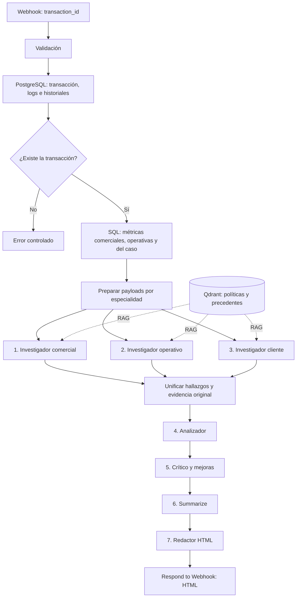

# Diagrama de la solución

[Arquitectura](README.md) · [Diagrama de la solución](DIAGRAMA_SOLUCION.md) · [RAG](RAG.md) · [Consultas SQL](QUERIES_SQL.md)

## Cómo funciona el flujo de investigación

La investigación comienza cuando n8n recibe el identificador de una transacción. A partir de ese dato, recupera la información necesaria desde PostgreSQL, calcula las métricas y prepara un contexto específico para cada investigador.

Los tres investigadores trabajan desde perspectivas distintas y pueden recuperar políticas y antecedentes desde Qdrant. Cuando terminan, sus resultados se combinan para que el Analizador evalúe las reglas y determine qué decisión recomienda la IA. El Crítico revisa esa conclusión y propone mejoras; después, Summarize arma el JSON final y el Redactor genera el informe HTML.

## Diagrama general

## Qué sucede en cada etapa

1. **Recepción y validación.** El webhook recibe el `transaction_id` y n8n verifica que la solicitud tenga el formato esperado.
2. **Consulta de datos.** PostgreSQL devuelve la transacción, sus eventos y los historiales relacionados. Si la transacción no existe, el flujo devuelve un error controlado.
3. **Cálculo de métricas.** Antes de ejecutar los agentes, n8n realiza las consultas SQL necesarias para obtener los indicadores comerciales, operativos y del caso.
4. **Preparación del contexto.** Se construye un payload diferente para cada investigador, de acuerdo con la información que necesita analizar.
5. **Investigación especializada.** Los agentes comercial, operativo y del cliente evalúan el caso desde sus respectivas perspectivas. Para complementar los datos estructurados, pueden buscar políticas y antecedentes relevantes en Qdrant.
6. **Integración de resultados.** n8n reúne los análisis y la evidencia original, evitando que se pierda el contexto de la investigación.
7. **Análisis y revisión.** El Analizador evalúa las políticas identificadas y recomienda `ACCEPT`, `REJECT` o `PENDING`. Después, el Crítico revisa esa recomendación, señala posibles problemas y propone mejoras, pero no decide nuevamente el contracargo.
8. **Generación del informe.** Summarize organiza toda la información en un JSON final y deja explícita la recomendación en `report_status`. El Redactor transforma ese JSON en HTML5 y n8n lo devuelve mediante el webhook.

## Por qué separé estas responsabilidades

La separación busca que cada herramienta haga el trabajo para el que resulta más adecuada. PostgreSQL se utiliza para consultar hechos y realizar cálculos precisos; Qdrant ayuda a encontrar documentación relacionada por su significado; y los agentes interpretan la información para construir una recomendación justificada.

También permite distinguir tres cosas que no deberían confundirse: el estado que ya tiene la transacción, la decisión que recomienda el Analizador y las acciones que realmente fueron ejecutadas. El informe presenta la recomendación, pero no cambia por sí mismo el estado del contracargo.

Para conocer las decisiones de arquitectura con más detalle, se puede volver al [README principal](README.md). Las secciones sobre [RAG](RAG.md) y [consultas SQL](QUERIES_SQL.md) explican cómo se obtiene la información utilizada en este flujo.
