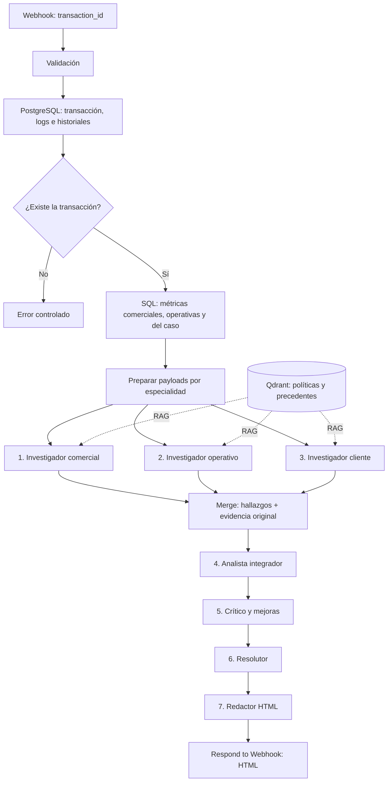

# Diagrama de la solución

[Arquitectura](README.md) · [Diagrama](DIAGRAMA_SOLUCION.md) · [RAG](RAG.md) · [Consultas SQL](QUERIES_SQL.md)

## Cómo fluye una investigación

### Diagrama de la solución

## Secuencia de procesamiento

1. El webhook recibe el `transaction_id` y n8n valida que la solicitud tenga el formato esperado.
2. PostgreSQL devuelve la transacción, sus eventos y los historiales relacionados.
3. Antes de llamar a los agentes, n8n calcula las métricas necesarias con consultas SQL.
4. n8n arma un contexto distinto para cada investigador: comercial, operativo y cliente.
5. Cada investigador consulta Qdrant para encontrar políticas y antecedentes relacionados.
6. n8n reúne los tres análisis con los datos originales del caso.
7. El analista revisa las políticas; después, el crítico señala riesgos y mejoras, y el resolutor plantea una recomendación.
8. Por último, el redactor prepara el HTML5 y n8n lo devuelve como respuesta al webhook.

## Separación de responsabilidades

- **PostgreSQL** se ocupa de los datos concretos y los cálculos.
- **Qdrant** encuentra documentos relacionados por significado.
- **Los agentes** interpretan la información y proponen recomendaciones, pero no ejecutan acciones operativas.

Ver [arquitectura general](README.md), [RAG](RAG.md) y [consultas SQL](QUERIES_SQL.md).
