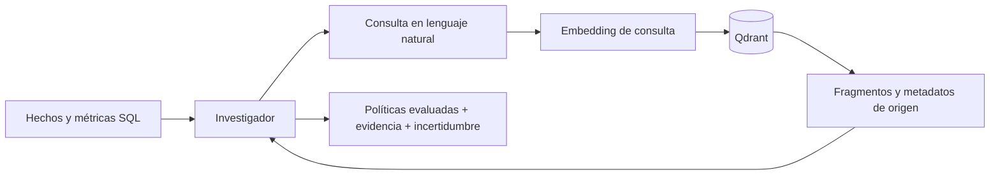

# RAG: recuperación aumentada por generación

[Arquitectura](README.md) · [Diagrama](DIAGRAMA_SOLUCION.md) · [RAG](RAG.md) · [Consultas SQL](QUERIES_SQL.md)

## 3. RAG: recuperación aumentada por generación

Uso **RAG** para que los agentes puedan consultar documentos relevantes mientras investigan, en lugar de depender solamente de lo que el modelo ya sabe. En este proyecto sirve para buscar **políticas internas** y **casos históricos parecidos**; no reemplaza las consultas exactas que hacemos en PostgreSQL.

### Flujo de recuperación

En el export anterior aparecen estos valores. Algunos todavía necesitan verificarse en la configuración activa:

- Colección: `chargeback_knowledge`.
- Modelo de embeddings: `text-embedding-3-small`, normalmente **1536 dimensiones** (verificar configuración efectiva).
- Filtros de metadatos: `metadata.source_type = internal_policy` para normas y `metadata.source_type = historical_case` para precedentes.
- `topK = 5` por búsqueda en el export anterior; no garantiza recuperar todo el catálogo.
- Distancia **Cosine** planteada en el diseño, pendiente de confirmar en la configuración real de Qdrant.

**Cómo planteo dividir los documentos:** dejar cada política completa en un fragmento, con su identificador, requisitos y excepciones. Para los casos históricos, usar un fragmento por caso cuando el tamaño lo permita, sin perder los hechos ni la resolución. No tengo documentado el workflow de ingesta, así que no puedo confirmar el `chunk_size`, el `chunk_overlap` ni qué splitter se usa realmente.

Los investigadores hacen búsquedas amplias, prueban conceptos y sinónimos, eliminan políticas duplicadas y buscan antecedentes relacionados con las **condiciones de las políticas**, no solo con el motivo del reclamo. Que dos textos sean parecidos **no demuestra** que una política aplique ni que el caso anterior se haya resuelto bien.

### ¿Por qué PostgreSQL y Qdrant?

| Necesidad | Tecnología | Motivo |
|---|---|---|
| Buscar `transaction_id`, logs o casos vinculados | PostgreSQL | Identidad y filtros exactos |
| Calcular `COUNT`, `SUM`, tasas, períodos y relaciones | PostgreSQL | Agregaciones y consistencia relacional |
| Encontrar una política expresada con otras palabras | Qdrant | Similitud semántica |
| Recuperar precedentes narrativamente parecidos | Qdrant | Búsqueda por significado |

Qdrant también permite filtrar payloads exactos con `/points/scroll`, pero eso **no es una búsqueda vectorial**. Tampoco reemplaza las relaciones, los cálculos ni las transacciones que manejamos en PostgreSQL.

## Límites de verificación

Los valores de configuración de arriba salen de un export anterior. Hay que confirmar la colección, los filtros, la dimensión, la distancia, `topK` y cómo funciona la ingesta actual. Además, una búsqueda vectorial no garantiza encontrar todas las políticas; para auditorías exhaustivas conviene complementarla con una recuperación determinística.

Ver [arquitectura](README.md) y [diagrama](DIAGRAMA_SOLUCION.md).
