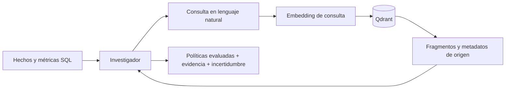

# RAG: recuperación aumentada por generación

[Arquitectura](README.md) · [Diagrama](DIAGRAMA_SOLUCION.md) · [RAG](RAG.md) · [Consultas SQL](QUERIES_SQL.md)

## 3. RAG: recuperación aumentada por generación

El **RAG** aporta al LLM conocimiento documental recuperado en el momento de investigar, sin depender exclusivamente del conocimiento del modelo. En este sistema se usa para **políticas internas** y **casos históricos similares**, no para reemplazar las consultas exactas de PostgreSQL.

### Flujo de recuperación

**Configuración documentada en el export anterior:**

- Colección: `chargeback_knowledge`.
- Modelo de embeddings: `text-embedding-3-small`, normalmente **1536 dimensiones** (verificar configuración efectiva).
- Filtros de metadatos: `metadata.source_type = internal_policy` para normas y `metadata.source_type = historical_case` para precedentes.
- `topK = 5` por búsqueda en el export anterior; no garantiza recuperar todo el catálogo.
- Distancia **Cosine** planteada en el diseño, pendiente de confirmar en la configuración real de Qdrant.

**Chunking definido conceptualmente:** una política completa por fragmento, incluyendo identificador, requisito y excepciones; un caso histórico por fragmento cuando su tamaño lo permita, conservando hechos y resolución. El workflow de ingesta no está disponible en la documentación, por lo que no se puede confirmar `chunk_size`, `chunk_overlap` ni el splitter real.

Los investigadores realizan búsquedas amplias, expanden consultas con conceptos y sinónimos, deduplican políticas y buscan precedentes relacionados con las **condiciones de las políticas**, no solamente con el motivo del reclamo. La similitud vectorial **no demuestra** que una norma se active ni que un caso anterior se haya resuelto correctamente.

### ¿Por qué PostgreSQL y Qdrant?

| Necesidad | Tecnología | Motivo |
|---|---|---|
| Buscar `transaction_id`, logs o casos vinculados | PostgreSQL | Identidad y filtros exactos |
| Calcular `COUNT`, `SUM`, tasas, períodos y relaciones | PostgreSQL | Agregaciones y consistencia relacional |
| Encontrar una política expresada con otras palabras | Qdrant | Similitud semántica |
| Recuperar precedentes narrativamente parecidos | Qdrant | Búsqueda por significado |

`/points/scroll` en Qdrant permite filtrar payloads exactos, pero **no es una búsqueda vectorial**. No sustituye las relaciones, cálculos y transacciones de PostgreSQL.

## Límites de verificación

La configuración mencionada corresponde al export anterior; deben verificarse colección, filtros, dimensión, distancia, `topK` y el workflow real de ingesta. Una búsqueda vectorial no garantiza recuperar todas las políticas; para auditorías exhaustivas conviene una recuperación determinística complementaria.

Ver [arquitectura](README.md) y [diagrama](DIAGRAMA_SOLUCION.md).
